<p align="center">
  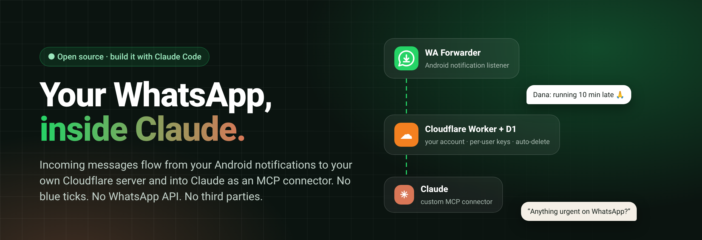
</p>

<p align="center">
  <a href="#-build-it-with-claude-code"></a>
  <a href="https://developers.cloudflare.com/workers/"></a>
  <a href="https://modelcontextprotocol.io"></a>
  
  <a href="LICENSE"></a>
</p>

<p align="center">
  <b>Ask Claude <i>"anything urgent on WhatsApp?"</i> and get a real answer.</b><br>
  A tiny Android app reads WhatsApp notifications, your own free Cloudflare server stores them,<br>
  and Claude reads them through a custom MCP connector. Messages on your phone stay <b>unread</b>.
</p>

<p align="center"><sub>Created by <a href="https://www.linkedin.com/in/ben-rotenberg/">Ben Rotenberg</a></sub></p>

<p align="center"><b>English</b> · <a href="#hebrew">עברית</a></p>

---

## ✨ What you get

<p align="center">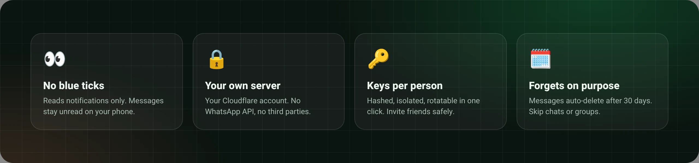</p>

<table>
<tr>
<td width="33%" align="center">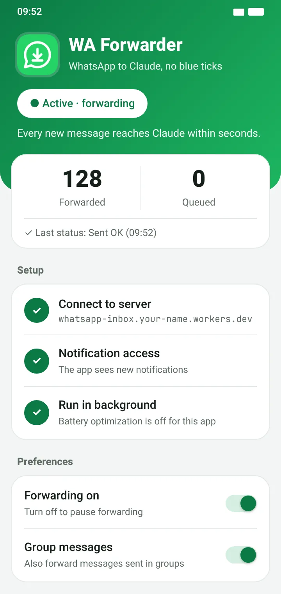<br><sub><b>WA Forwarder</b>: the Android app</sub></td>
<td width="33%" align="center">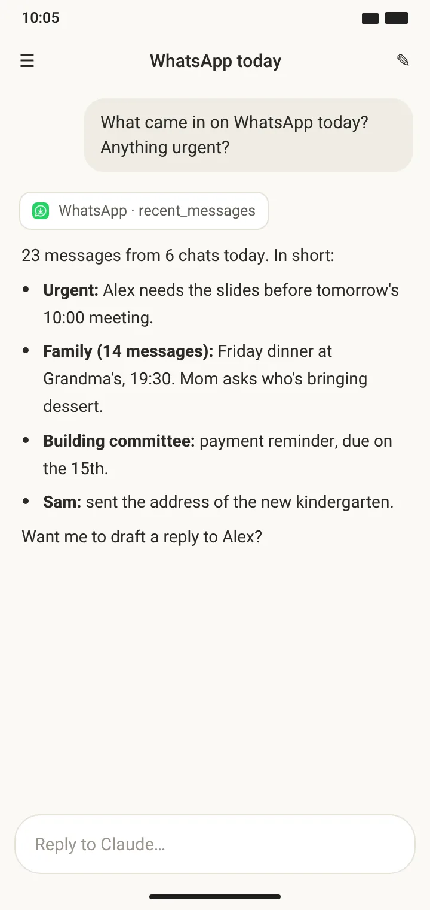<br><sub><b>Claude</b>: search, summarize, catch up</sub></td>
<td width="33%" align="center">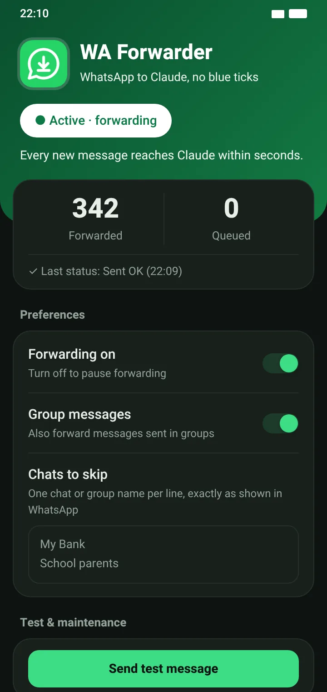<br><sub>Skip chats, skip groups, dark mode</sub></td>
</tr>
</table>

- 👀 **No blue ticks.** The app only reads the notification. It never opens WhatsApp or the chat.
- 🔒 **Yours.** Runs on your own Cloudflare account (free plan). No WhatsApp API, no linked device, no third-party service.
- 🧑‍🤝‍🧑 **Friends welcome.** Multi-user: each person gets their own keys, their own inbox, and a one-tap setup link with a QR code.
- 🗓️ **Forgets on purpose.** Messages auto-delete after 30 days (configurable per user).
- 🧰 **Four MCP tools:** `recent_messages`, `search_messages`, `list_chats`, `get_conversation`.
- 🛠️ **No Android Studio.** The APK builds and signs from a single script, with a key generated just for you.

## 📋 What you need

**Accounts** (all free, except Claude):

| | What | Notes |
|---|---|---|
| ☁️ | **Cloudflare account** | Free plan is enough. Sign up at [dash.cloudflare.com/sign-up](https://dash.cloudflare.com/sign-up), verify your email, then open **Workers & Pages** once and choose your `workers.dev` subdomain (it becomes part of your server address). No credit card needed. |
| ✳️ | **Claude account** with custom connectors | Used to add the WhatsApp connector at claude.ai → Settings → Connectors. Custom connectors may require a paid plan. |
| 🐙 | GitHub (optional) | Only to clone this repo. You can also download it as a ZIP. |

**Devices:**

- 💻 **A computer** (Windows, macOS or Linux) with [Claude Code](https://claude.com/claude-code). It builds and deploys everything.
- 📱 **An Android phone (8+)** with WhatsApp. iPhone isn't supported.

**Software** (Claude Code checks these and offers to install what's missing):

| Tool | Why |
|---|---|
| Node.js 20+ | Runs Wrangler, Cloudflare's CLI, to deploy the server |
| JDK 17+ | Compiles and signs the Android app |
| Python 3 | Small build helpers (zip alignment) |
| Git + bash | Git Bash on Windows; built in on macOS/Linux |

No Android Studio or Android SDK: the build script downloads the few tools it needs from Maven Central.

### The three big steps

<p align="center">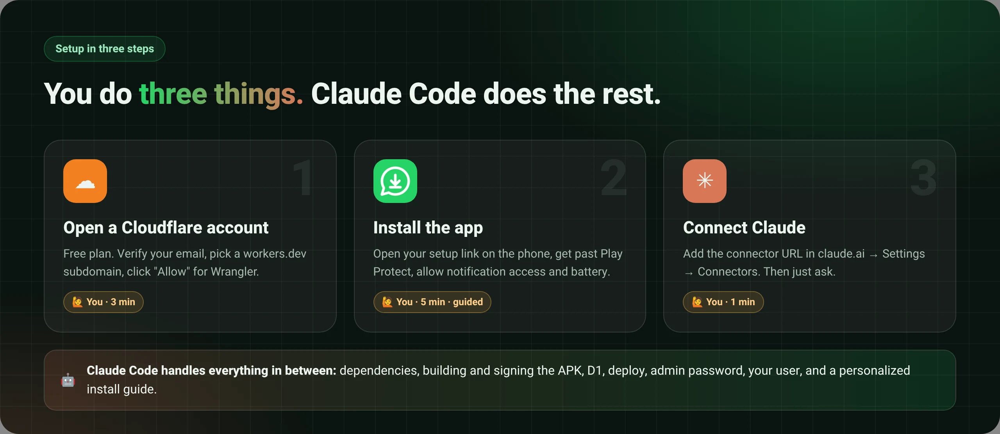</p>

1. **☁️ Open a Cloudflare account** and pick your `workers.dev` subdomain (above). Claude Code then logs Wrangler in (you click **Allow**), deploys the server and creates its database.
2. **📱 Install the app** on your phone from your personal setup link: download, get past Play Protect, allow restricted settings, notification access and battery. **[Illustrated step-by-step guide →](docs/install-app.md)**
3. **✳️ Connect Claude**: add the connector URL in claude.ai → Settings → Connectors. Done.

At the end Claude Code also makes you a **personalized install guide** (a polished web page with your server's address) to keep or share with friends.

## 🤖 Build it with Claude Code

This repo is written to be **built by Claude Code for you**. [`CLAUDE.md`](CLAUDE.md) is a step-by-step playbook:
Claude installs what's missing, builds and signs the app, deploys the server to your Cloudflare account, creates
your user, connects the connector, and finishes with a **personalized, illustrated install guide**.
It uses Claude's browser tools for the web steps and stops only when a human is needed.

```bash
git clone https://github.com/Ben-Rotenberg/whatsapp-claude-inbox.git
cd whatsapp-claude-inbox
claude
```

Then just say:

> **Set this up for me.**

Before it touches anything, Claude shows you the [disclaimer](#disclaimer) and asks you to accept it. Using this tool is at your own discretion and risk.

### 🙋 Where you'll need to step in

| When | What you do | Why Claude can't |
|---|---|---|
| Cloudflare | Sign up / sign in, verify your email, pick a `workers.dev` subdomain | Your account, your password |
| `wrangler login` | Click **Allow** on Cloudflare's consent page | OAuth consent is yours to give |
| claude.ai | Approve adding the custom connector (Claude can fill it in with a browser tool) | Your account |
| Phone | Install the APK, get past **Play Protect**, **Allow restricted settings**, grant **notification access**, turn off **battery optimization** | It's your phone 🙂 |

Everything else (dependencies, build, signing key, D1, deploy, admin password, your user, the guide) is on Claude.

## 🧭 How it works

<p align="center">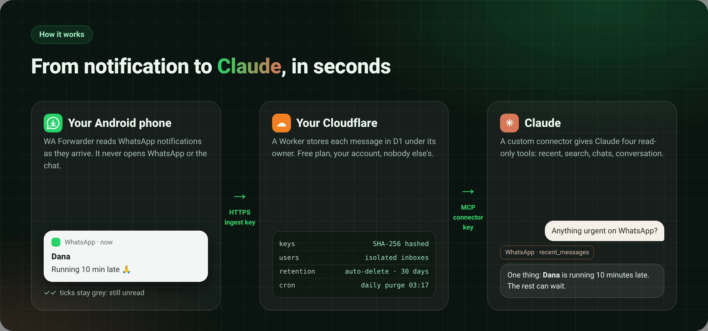</p>

<details>
<summary>Technical diagram</summary>

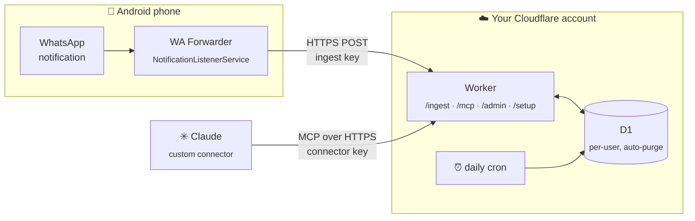

</details>

1. **WA Forwarder** listens for WhatsApp notifications and POSTs sender, chat and text to `/ingest`, with a retry queue for when you're offline.
2. The **Worker** stores them in **D1** under the user that owns the key. Keys are random and stored only as SHA-256 hashes.
3. **Claude** talks to `/mcp/<your key>` over Streamable HTTP. Every query is scoped to that one user.
4. A **daily cron** deletes messages older than each user's retention.

## 🛠️ Build it by hand

<details>
<summary>Prefer to do it yourself? Six commands.</summary>

Needs Node 20+, JDK 17+, Python 3 and bash (Git Bash on Windows; use `npx.cmd` in PowerShell).

```bash
npm install
bash android/build.sh                 # builds + signs public/wa-forwarder.apk with a fresh key in android/signing/
npx wrangler login
npx wrangler deploy                   # creates the Worker and the D1 database
npx wrangler secret put ADMIN_TOKEN   # a long random password for /admin
node guide/make-guide.mjs --server https://whatsapp-inbox.<you>.workers.dev --owner "<You>"
```

Then open `https://whatsapp-inbox.<you>.workers.dev/admin`, create a user, open its setup link on your phone, and
add the connector URL in claude.ai → Settings → Connectors → **Add custom connector**.

Local development: `cp .dev.vars.example .dev.vars && npx wrangler dev` → http://localhost:8787/admin

</details>

## 📖 The install guide

<table>
<tr>
<td align="center">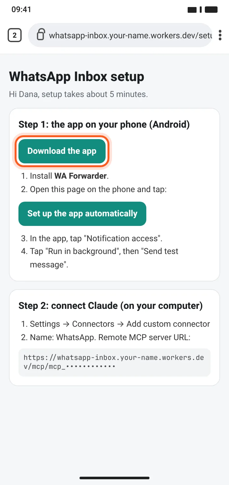<br><sub>1 · Setup link</sub></td>
<td align="center">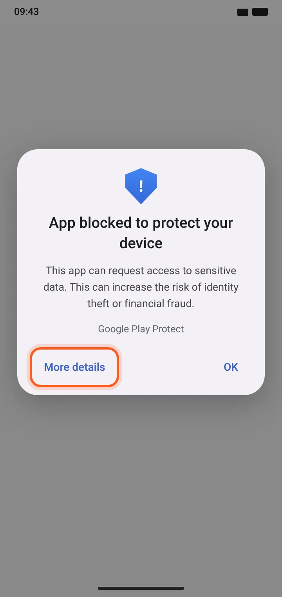<br><sub>2 · Play Protect</sub></td>
<td align="center">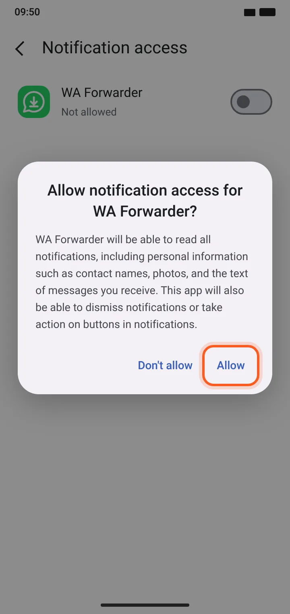<br><sub>3 · Notification access</sub></td>
<td align="center">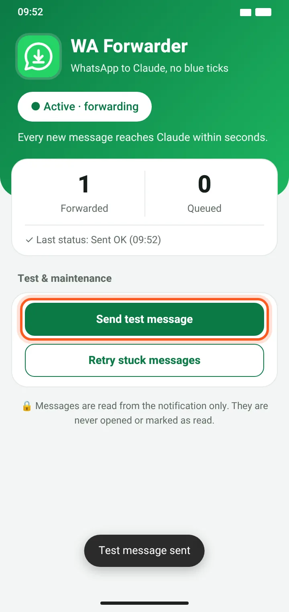<br><sub>4 · Ready</sub></td>
</tr>
</table>

`guide/make-guide.mjs` turns [`guide/template.html`](guide/template.html) into a polished, illustrated, mobile-friendly
guide with your server's address, for you (`--for owner`) or for friends you invite (`--for friend`).
It never includes keys or links: only your public server URL.

## 🔐 Privacy & security

- The app reads **notifications only**. It needs Android's notification-access permission, which lets it see all notifications; it forwards only WhatsApp's.
- Each user gets two random keys (app and Claude). The server stores **only their hashes**. Setup links carry keys in the URL `#fragment`, which browsers never send to the server.
- Users are isolated: one user's keys can never read another user's messages. A leaked key can be rotated from `/admin` in one click.
- D1 is encrypted at rest by Cloudflare, but **whoever controls the Cloudflare account can technically read stored messages**. If you invite friends, tell them.
- You can skip specific chats, or all groups, right in the app.
- Nothing in this repo is tied to anyone's account: no IDs, URLs, keys or signing certificates. Yours are created fresh when you build.

<a id="disclaimer"></a>

## ⚠️ Disclaimer: use at your own discretion and risk

**This tool is provided "as is", without warranty of any kind. Using it is entirely at your own discretion and your own responsibility.**
By building, deploying, installing or sharing it, you accept that:

- **You are responsible** for how you use it, for the server you run, and for the messages it stores. The authors and contributors accept no liability for any damage, data loss, account issues, privacy incidents or other consequences.
- **Other people's messages are involved.** The messages you forward were written by others. Make sure your use complies with the laws where you live (privacy, data protection, interception) and with WhatsApp's and Google's terms. If you invite friends, they are trusting you with their messages.
- **You are lowering phone protections on purpose.** Sideloading, briefly turning off Play Protect, and allowing "restricted settings" and notification access all reduce your phone's built-in safeguards. Only do it if you understand and accept that.
- **It may break** at any time (WhatsApp, Android, Cloudflare or Claude changes), and messages can be missed, delayed or cut off. Don't rely on it for anything important or urgent.

### Know before you install

This is an **experimental, personal project**, not a product. Installing it means sideloading an APK, temporarily
working around Google Play Protect, and allowing Android "restricted settings" so the app can read notifications.
That's fine for a tool you built yourself, but it isn't for everyone. Muted chats, chats you have open on screen,
and media (beyond "📷 Photo" and its caption) don't appear in notifications, so they won't reach Claude either.
Android only; iOS doesn't allow reading other apps' notifications.

Not affiliated with WhatsApp, Meta, Cloudflare or Anthropic. All screenshots are mockups with made-up data.

## 🗂️ Repo map

```
├── CLAUDE.md            ← the playbook Claude Code follows
├── src/                 ← Cloudflare Worker: ingest, MCP server, admin + setup pages, D1
├── android/             ← WA Forwarder (plain Java, no Gradle) + build.sh (no Android SDK needed)
├── guide/               ← install-guide template + generator
├── docs/                ← app install guide (EN/HE), images, and the mockups they're rendered from
├── public/              ← icons (the APK lands here at build time)
└── wrangler.jsonc       ← Worker config, no account-specific values
```

<p align="center"><sub>Provided as is, with no warranty. Use at your own discretion and risk.</sub><br><sub>Created by <a href="https://www.linkedin.com/in/ben-rotenberg/"><b>Ben Rotenberg</b></a> · MIT licensed · Built with <a href="https://claude.com/claude-code">Claude Code</a></sub></p>

---

<a id="hebrew"></a>

<div dir="rtl" lang="he">

## 🇮🇱 עברית

**שואלים את Claude ״יש משהו דחוף בווצאפ?״ ומקבלים תשובה אמיתית.**
אפליקציה קטנה באנדרואיד קוראת את ההתראות של ווצאפ, שרת Cloudflare חינמי משלכם שומר אותן, ו־Claude קורא אותן דרך connector מסוג MCP. ההודעות בטלפון נשארות **לא נקראות**.

### ✨ מה מקבלים

<p align="center">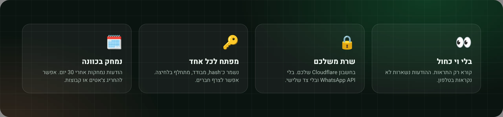</p>

- 👀 **בלי וי כחול.** האפליקציה קוראת רק את ההתראה. היא לא פותחת את ווצאפ ולא את הצ׳אט.
- 🔒 **הכול שלכם.** רץ על חשבון Cloudflare שלכם (התוכנית החינמית מספיקה). בלי WhatsApp API, בלי מכשיר מקושר ובלי שירות צד שלישי.
- 🧑‍🤝‍🧑 **אפשר לצרף חברים.** לכל משתמש מפתחות משלו, תיבה משלו וקישור הגדרה בלחיצה אחת, עם קוד QR.
- 🗓️ **נמחק בכוונה.** הודעות נמחקות אוטומטית אחרי 30 יום (אפשר לשנות לכל משתמש).
- 🧰 **ארבעה כלי MCP:** `recent_messages`, `search_messages`, `list_chats`, `get_conversation`.
- 🛠️ **בלי Android Studio.** קובץ ה־APK נבנה ונחתם בסקריפט אחד, עם מפתח חתימה שנוצר במיוחד בשבילכם.

### 📋 מה צריך

**חשבונות** (כולם בחינם, חוץ מ־Claude):

| | מה | הערות |
|---|---|---|
| ☁️ | **חשבון Cloudflare** | התוכנית החינמית מספיקה. נרשמים ב־[dash.cloudflare.com/sign-up](https://dash.cloudflare.com/sign-up), מאמתים את המייל, ואז נכנסים פעם אחת ל־**Workers & Pages** ובוחרים תת־דומיין של `workers.dev`, שיהיה חלק מכתובת השרת שלכם. לא צריך כרטיס אשראי. |
| ✳️ | **חשבון Claude** עם connectors מותאמים אישית | שם מוסיפים את ה־connector של WhatsApp: claude.ai ← Settings ← Connectors. ייתכן שצריך מנוי בתשלום. |
| 🐙 | GitHub (לא חובה) | רק כדי לשכפל את הריפו. אפשר גם להוריד אותו כ־ZIP. |

**מכשירים:**

- 💻 **מחשב** (Windows, macOS או Linux) עם [Claude Code](https://claude.com/claude-code). הוא בונה ומעלה הכול.
- 📱 **טלפון אנדרואיד** (גרסה 8 ומעלה) עם ווצאפ. אייפון לא נתמך.

**תוכנות** (Claude Code בודק אותן ומציע להתקין את מה שחסר):

| כלי | בשביל מה |
|---|---|
| Node.js 20+ | מריץ את Wrangler, הכלי של Cloudflare, כדי להעלות את השרת |
| JDK 17+ | מהדר וחותם את אפליקציית האנדרואיד |
| Python 3 | כלי עזר קטנים לבנייה |
| Git + bash | ב־Windows זה Git Bash. ב־macOS וב־Linux הם כבר מותקנים |

לא צריך Android Studio או Android SDK: סקריפט הבנייה מוריד בעצמו את הכלים המעטים שהוא צריך.

### שלושת השלבים הגדולים

<p align="center">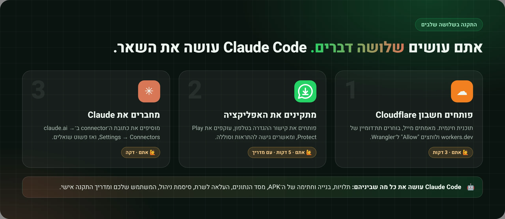</p>

1. **☁️ פותחים חשבון Cloudflare** ובוחרים תת־דומיין של `workers.dev` (כמו שמתואר למעלה). משם Claude Code מחבר את Wrangler (אתם רק לוחצים **Allow**), מעלה את השרת ויוצר את מסד הנתונים.
2. **📱 מתקינים את האפליקציה** בטלפון מקישור ההגדרה האישי: הורדה, עקיפת Play Protect, אישור הגדרות מוגבלות, גישה להתראות וסוללה. **[המדריך המאויר, שלב אחר שלב ←](docs/install-app.he.md)**
3. **✳️ מחברים את Claude**: מוסיפים את כתובת ה־connector ב־claude.ai ← Settings ← Connectors. זהו.

בסוף, Claude Code מכין גם **מדריך התקנה אישי**: דף אינטרנט מעוצב עם כתובת השרת שלכם, שאפשר לשמור או לשתף עם חברים.

### 🤖 בונים את זה עם Claude Code

הריפו נכתב כך ש־**Claude Code יבנה אותו בשבילכם**. הקובץ [`CLAUDE.md`](CLAUDE.md) הוא מדריך עבודה מסודר: Claude מתקין את מה שחסר, בונה וחותם את האפליקציה, מעלה את השרת לחשבון ה־Cloudflare שלכם, יוצר לכם משתמש, מחבר את ה־connector, ובסוף מכין **מדריך התקנה אישי ומאויר**. בשלבים שבדפדפן הוא משתמש בדפדפן של Claude, ועוצר רק כשצריך אתכם.

```bash
git clone https://github.com/Ben-Rotenberg/whatsapp-claude-inbox.git
cd whatsapp-claude-inbox
claude
```

ואז פשוט כותבים: **Set this up for me.**

לפני שהוא נוגע במשהו, Claude מציג את [הצהרת האחריות](#disclaimer-he) ומבקש את אישורכם. השימוש בכלי הוא לשיקול דעתכם ובאחריותכם בלבד.

### 🙋 איפה תצטרכו להתערב

| מתי | מה עושים | למה Claude לא יכול |
|---|---|---|
| Cloudflare | נרשמים או מתחברים, מאמתים את המייל ובוחרים תת־דומיין של `workers.dev` | החשבון והסיסמה שלכם |
| `wrangler login` | לוחצים **Allow** בדף האישור של Cloudflare | את ההרשאה נותנים רק אתם |
| claude.ai | מאשרים את הוספת ה־connector (עם כלי דפדפן, Claude ממלא את הפרטים) | החשבון שלכם |
| הטלפון | מתקינים את ה־APK, עוקפים את **Play Protect**, מאשרים **הגדרות מוגבלות**, נותנים **גישה להתראות** ומבטלים **חיסכון בסוללה** | זה הטלפון שלכם 🙂 |

כל השאר באחריות Claude: תלויות, בנייה, מפתח חתימה, מסד הנתונים D1, העלאה לשרת, סיסמת הניהול, המשתמש שלכם והמדריך.

### 🧭 איך זה עובד

<p align="center">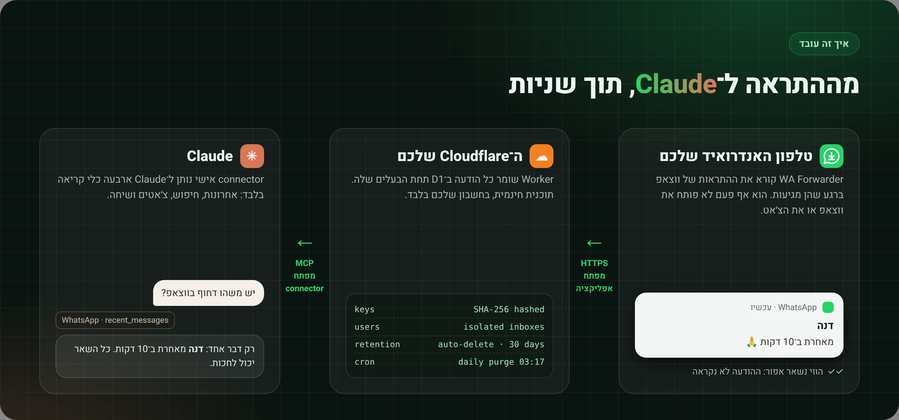</p>

1. **WA Forwarder** מאזין להתראות של ווצאפ ושולח את השולח, שם הצ׳אט והטקסט אל `/ingest`. כשאין אינטרנט ההודעות ממתינות בתור ונשלחות אחר כך.
2. ה־**Worker** שומר אותן ב־**D1** תחת המשתמש שהמפתח שייך לו. המפתחות אקראיים, והשרת שומר רק את ה־hash שלהם.
3. **Claude** פונה אל `/mcp/<המפתח שלכם>`, וכל שאילתה מוגבלת למשתמש הזה בלבד.
4. **משימה יומית** מוחקת הודעות שעברו את תקופת השמירה של כל משתמש.

### 📖 מדריך ההתקנה

הסקריפט `guide/make-guide.mjs` הופך את [`guide/template.html`](guide/template.html) למדריך מאויר ומותאם לנייד, עם כתובת השרת שלכם. אפשר להפיק גרסה לבעלים (`--for owner`) וגרסה לחברים שמזמינים (`--for friend`). המדריך לא כולל אף פעם מפתחות או קישורים אישיים, רק את כתובת השרת הציבורית.

### 🔐 פרטיות ואבטחה

- האפליקציה קוראת **התראות בלבד**. היא צריכה הרשאת גישה להתראות, שמאפשרת לראות את כל ההתראות, אבל היא מעבירה רק את אלה של ווצאפ.
- לכל משתמש שני מפתחות אקראיים, אחד לאפליקציה ואחד ל־Claude, והשרת שומר **רק את ה־hash שלהם**. קישורי ההגדרה מעבירים את המפתחות אחרי ה־`#` בכתובת, חלק שהדפדפן אף פעם לא שולח לשרת.
- המשתמשים מופרדים זה מזה: המפתחות של משתמש אחד לא מאפשרים לקרוא הודעות של אחר. מפתח שדלף מחליפים בלחיצה אחת בדף הניהול.
- Cloudflare מצפינה את D1 בדיסק, אבל **מי ששולט בחשבון ה־Cloudflare יכול טכנית לקרוא את ההודעות השמורות**. אם מזמינים חברים, חשוב לספר להם.
- באפליקציה אפשר להחריג צ׳אטים מסוימים, או את כל הקבוצות.
- שום דבר בריפו לא קשור לחשבון של מישהו: אין בו מזהים, כתובות, מפתחות או תעודות חתימה. שלכם נוצרים מחדש כשאתם בונים.

<a id="disclaimer-he"></a>

### ⚠️ הצהרת אחריות: השימוש לשיקול דעתכם ובאחריותכם

**הכלי ניתן ״כמות שהוא״ (AS IS), ללא אחריות מכל סוג. השימוש בו הוא לשיקול דעתכם ובאחריותכם הבלעדית.**
מי שבונה, מעלה לשרת, מתקין או משתף את הכלי מקבל על עצמו ש:

- **האחריות עליכם** לאופן השימוש, לשרת שאתם מפעילים ולהודעות שנשמרות בו. היוצרים והתורמים לא אחראים לשום נזק, אובדן מידע, בעיה בחשבון, פגיעה בפרטיות או כל תוצאה אחרת.
- **מדובר בהודעות של אנשים אחרים.** ההודעות שמועברות נכתבו על ידי אחרים. ודאו שהשימוש שלכם עומד בחוק במקום מגוריכם (פרטיות, הגנת מידע, האזנה) ובתנאי השימוש של WhatsApp ושל Google. חברים שתזמינו סומכים עליכם עם ההודעות שלהם.
- **אתם מורידים בכוונה הגנות בטלפון.** התקנה מחוץ לחנות, כיבוי זמני של Play Protect, אישור ״הגדרות מוגבלות״ וגישה להתראות מחלישים את מנגנוני ההגנה של הטלפון. עשו זאת רק אם אתם מבינים ומקבלים את זה.
- **הכלי עלול להפסיק לעבוד** בכל רגע (בעקבות שינויים בווצאפ, באנדרואיד, ב־Cloudflare או ב־Claude), והודעות עלולות להתפספס, להתעכב או להיחתך. אל תסתמכו עליו לשום דבר חשוב או דחוף.

### מה כדאי לדעת לפני ההתקנה

זה **פרויקט אישי וניסיוני**, לא מוצר. ההתקנה כוללת התקנת APK מחוץ לחנות, עקיפה זמנית של Google Play Protect, ואישור ״הגדרות מוגבלות״ באנדרואיד כדי שהאפליקציה תוכל לקרוא התראות. זה סביר לכלי שבניתם בעצמכם, אבל זה לא מתאים לכולם. הודעות מצ׳אטים מושתקים, מצ׳אטים שפתוחים מולכם על המסך, ומדיה (מעבר ל־״📷 תמונה״ והכיתוב) לא מופיעות בהתראות, ולכן גם לא יגיעו ל־Claude. אנדרואיד בלבד: אייפון לא מאפשר לקרוא התראות של אפליקציות אחרות.

הפרויקט לא קשור ל־WhatsApp, ל־Meta, ל־Cloudflare או ל־Anthropic. כל צילומי המסך הם הדמיות עם נתונים בדויים.

<p align="center"><sub>נוצר על ידי <a href="https://www.linkedin.com/in/ben-rotenberg/">Ben Rotenberg</a> · רישיון MIT</sub></p>

</div>
