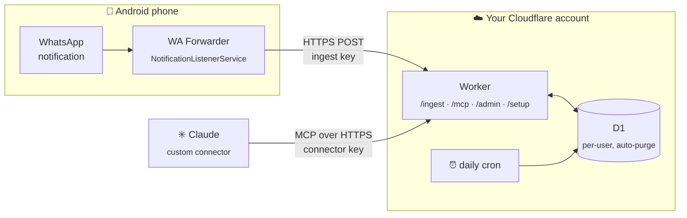

<p align="center">
  
</p>

<p align="center">
  <a href="#-build-it-with-claude-code"></a>
  <a href="https://developers.cloudflare.com/workers/"></a>
  <a href="https://modelcontextprotocol.io"></a>
  
  <a href="LICENSE"></a>
</p>

<p align="center">
  <b>Ask Claude <i>"anything urgent on WhatsApp?"</i> and get a real answer.</b><br>
  A tiny Android app reads WhatsApp notifications, your own free Cloudflare server stores them,<br>
  and Claude reads them through a custom MCP connector. Messages on your phone stay <b>unread</b>.
</p>

---

## ✨ What you get

<table>
<tr>
<td width="33%" align="center"><br><sub><b>WA Forwarder</b>: the Android app</sub></td>
<td width="33%" align="center"><br><sub><b>Claude</b>: search, summarize, catch up</sub></td>
<td width="33%" align="center"><br><sub>Skip chats, skip groups, dark mode</sub></td>
</tr>
</table>

- 👀 **No blue ticks.** The app only reads the notification. It never opens WhatsApp or the chat.
- 🔒 **Yours.** Runs on your own Cloudflare account (free plan). No WhatsApp API, no linked device, no third-party service.
- 🧑‍🤝‍🧑 **Friends welcome.** Multi-user: each person gets their own keys, their own inbox, and a one-tap setup link with a QR code.
- 🗓️ **Forgets on purpose.** Messages auto-delete after 30 days (configurable per user).
- 🧰 **Four MCP tools:** `recent_messages`, `search_messages`, `list_chats`, `get_conversation`.
- 🛠️ **No Android Studio.** The APK builds and signs from a single script, with a key generated just for you.

## 🤖 Build it with Claude Code

This repo is written to be **built by Claude Code for you**. [`CLAUDE.md`](CLAUDE.md) is a step-by-step playbook:
Claude installs what's missing, builds and signs the app, deploys the server to your Cloudflare account, creates
your user, connects the connector, and finishes with a **personalized, illustrated install guide**.
It uses Claude's browser tools for the web steps and stops only when a human is needed.

```bash
git clone https://github.com/Ben-Rotenberg/whatsapp-claude-inbox.git
cd whatsapp-claude-inbox
claude
```

Then just say:

> **Set this up for me.**

### 🙋 Where you'll need to step in

| When | What you do | Why Claude can't |
|---|---|---|
| Cloudflare | Sign up / sign in, verify your email, pick a `workers.dev` subdomain | Your account, your password |
| `wrangler login` | Click **Allow** on Cloudflare's consent page | OAuth consent is yours to give |
| claude.ai | Approve adding the custom connector (Claude can fill it in with a browser tool) | Your account |
| Phone | Install the APK, get past **Play Protect**, **Allow restricted settings**, grant **notification access**, turn off **battery optimization** | It's your phone 🙂 |

Everything else (dependencies, build, signing key, D1, deploy, admin password, your user, the guide) is on Claude.

## 🧭 How it works



1. **WA Forwarder** listens for WhatsApp notifications and POSTs sender, chat and text to `/ingest`, with a retry queue for when you're offline.
2. The **Worker** stores them in **D1** under the user that owns the key. Keys are random and stored only as SHA-256 hashes.
3. **Claude** talks to `/mcp/<your key>` over Streamable HTTP. Every query is scoped to that one user.
4. A **daily cron** deletes messages older than each user's retention.

## 🛠️ Build it by hand

<details>
<summary>Prefer to do it yourself? Six commands.</summary>

Needs Node 20+, JDK 17+, Python 3 and bash (Git Bash on Windows; use `npx.cmd` in PowerShell).

```bash
npm install
bash android/build.sh                 # builds + signs public/wa-forwarder.apk with a fresh key in android/signing/
npx wrangler login
npx wrangler deploy                   # creates the Worker and the D1 database
npx wrangler secret put ADMIN_TOKEN   # a long random password for /admin
node guide/make-guide.mjs --server https://whatsapp-inbox.<you>.workers.dev --owner "<You>"
```

Then open `https://whatsapp-inbox.<you>.workers.dev/admin`, create a user, open its setup link on your phone, and
add the connector URL in claude.ai → Settings → Connectors → **Add custom connector**.

Local development: `cp .dev.vars.example .dev.vars && npx wrangler dev` → http://localhost:8787/admin

</details>

## 📖 The install guide

<table>
<tr>
<td align="center"><br><sub>1 · Setup link</sub></td>
<td align="center"><br><sub>2 · Play Protect</sub></td>
<td align="center"><br><sub>3 · Notification access</sub></td>
<td align="center"><br><sub>4 · Ready</sub></td>
</tr>
</table>

`guide/make-guide.mjs` turns [`guide/template.html`](guide/template.html) into a polished, illustrated, mobile-friendly
guide with your server's address, for you (`--for owner`) or for friends you invite (`--for friend`).
It never includes keys or links: only your public server URL.

## 🔐 Privacy & security

- The app reads **notifications only**. It needs Android's notification-access permission, which lets it see all notifications; it forwards only WhatsApp's.
- Each user gets two random keys (app and Claude). The server stores **only their hashes**. Setup links carry keys in the URL `#fragment`, which browsers never send to the server.
- Users are isolated: one user's keys can never read another user's messages. A leaked key can be rotated from `/admin` in one click.
- D1 is encrypted at rest by Cloudflare, but **whoever controls the Cloudflare account can technically read stored messages**. If you invite friends, tell them.
- You can skip specific chats, or all groups, right in the app.
- Nothing in this repo is tied to anyone's account: no IDs, URLs, keys or signing certificates. Yours are created fresh when you build.

## ⚠️ Know before you install

This is an **experimental, personal project**, not a product. Installing it means sideloading an APK, temporarily
working around Google Play Protect, and allowing Android "restricted settings" so the app can read notifications.
That's fine for a tool you built yourself, but it isn't for everyone. Muted chats, chats you have open on screen,
and media (beyond "📷 Photo" and its caption) don't appear in notifications, so they won't reach Claude either.
Android only; iOS doesn't allow reading other apps' notifications.

Not affiliated with WhatsApp, Meta, Cloudflare or Anthropic. All screenshots are mockups with made-up data.

## 🗂️ Repo map

```
├── CLAUDE.md            ← the playbook Claude Code follows
├── src/                 ← Cloudflare Worker: ingest, MCP server, admin + setup pages, D1
├── android/             ← WA Forwarder (plain Java, no Gradle) + build.sh (no Android SDK needed)
├── guide/               ← install-guide template + generator
├── docs/                ← images, and the mockups they're rendered from
├── public/              ← icons (the APK lands here at build time)
└── wrangler.jsonc       ← Worker config, no account-specific values
```

<p align="center"><sub>MIT licensed · Built with <a href="https://claude.com/claude-code">Claude Code</a></sub></p>
