

# 📱 התקנת האפליקציה WA Forwarder

[English](install-app.md) · **עברית**

קודם צריך **קישור הגדרה אישי**. מי שמנהל את השרת יוצר אותו בדף הניהול (`/admin`).
זה לוקח בערך 10 דקות. המסגרת הכתומה בכל צילום מסך מסמנת על מה ללחוץ. כל הערכים בצילומים בדויים.

> ⚠️ השימוש בכלי הוא לשיקול דעתכם ובאחריותכם בלבד. ראו את [הצהרת האחריות](../README.md#disclaimer-he).

| | שלב | |
|---|---|---|
| **1** | **פותחים את קישור ההגדרה בטלפון**, בכרום (או סורקים את קוד ה־QR). לוחצים **Download the app** ומשאירים את הדף פתוח. | 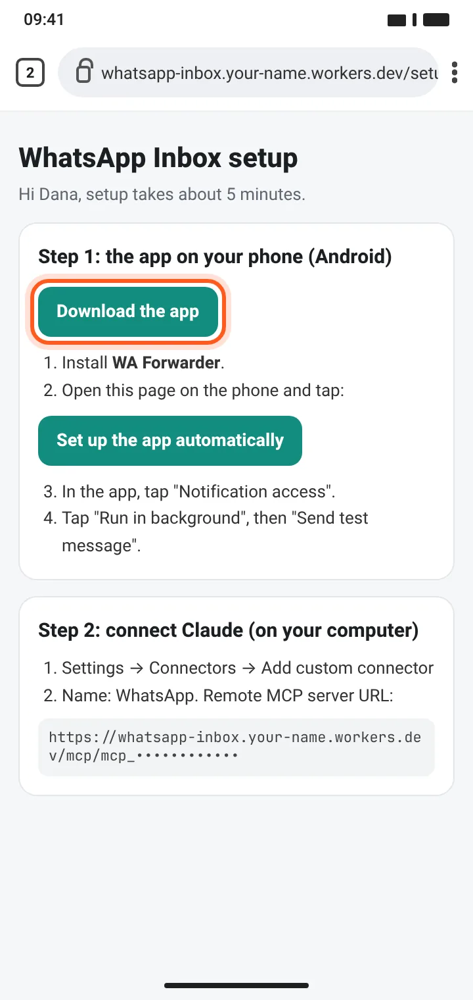 |
| **2** | **מאשרים את ההורדה.** כרום מזהיר על כל קובץ שלא הגיע מ־Google Play. לוחצים **Download anyway** ואז **Open**. | 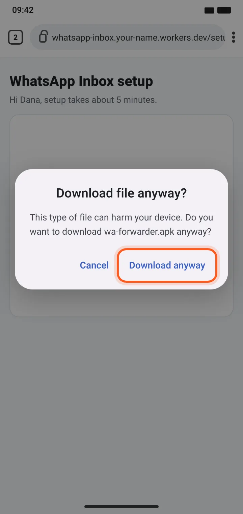 |
| **3** | **נותנים לכרום להתקין אפליקציות.** Settings ← מדליקים **Allow from this source** ← חוזרים אחורה. אם המסך לא הופיע, ההרשאה כבר קיימת. | 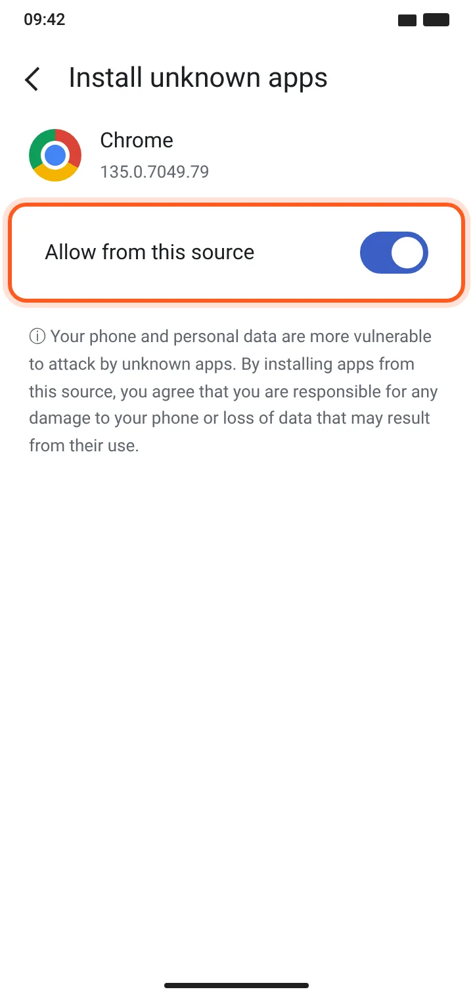 |
| **4** | **עוקפים את Play Protect.** לוחצים **More details ← Install anyway**. אם האפשרות לא מופיעה: ב־Google Play נכנסים לפרופיל ← Play Protect ← ⚙️, מכבים את **Scan apps with Play Protect**, מתקינים, ו**מדליקים את הסריקה שוב** אחרי ההתקנה. | 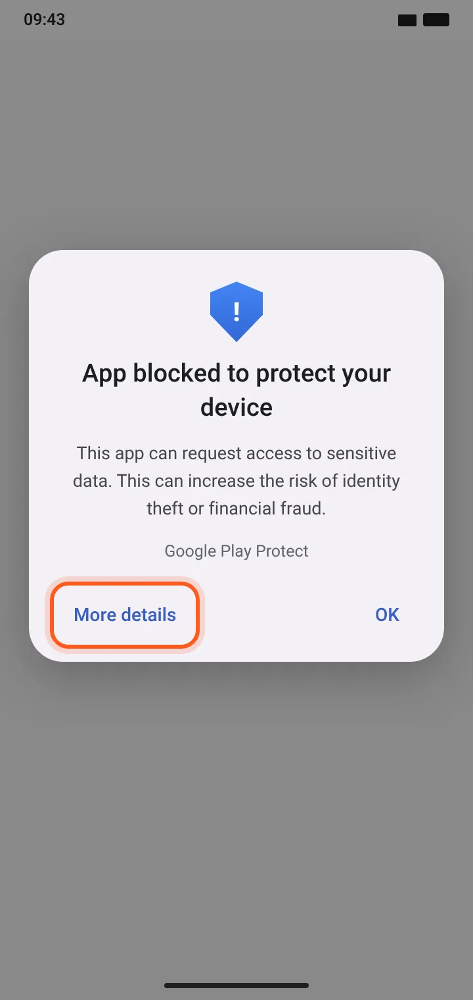 |
| **5** | **מתקינים.** מופיע ״App not installed״? מסירים קודם גרסה ישנה שנחתמה במפתח אחר. | 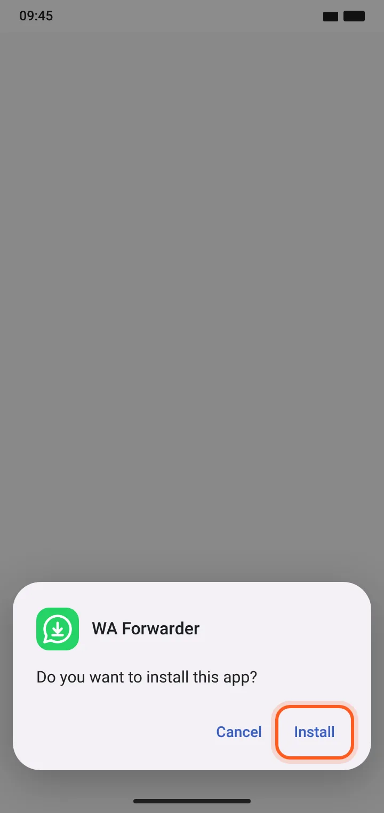 |
| **6** | **הגדרה בלחיצה אחת.** חוזרים לדף ההגדרה ולוחצים **Set up the app automatically**. השלב ״Connect to server״ הופך לירוק. אחר כך לוחצים **Allow** ליד **Notification access**. | 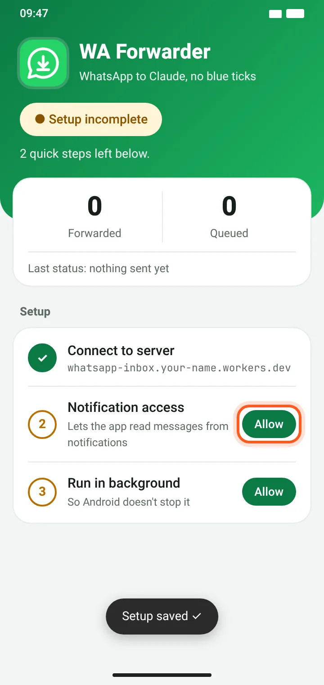 |
| **7** | **הגדרה מוגבלת** (אנדרואיד 13 ומעלה). אם המתג אפור, לוחצים OK, ואז: הגדרות ← אפליקציות ← WA Forwarder ← **⋮ ← Allow restricted settings**. | 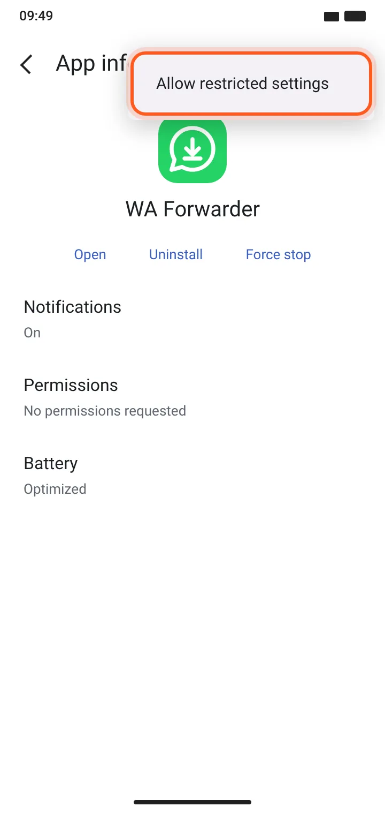 |
| **8** | **מאשרים גישה להתראות.** חוזרים לאפליקציה, לוחצים שוב **Allow**, מדליקים את המתג ומאשרים. | 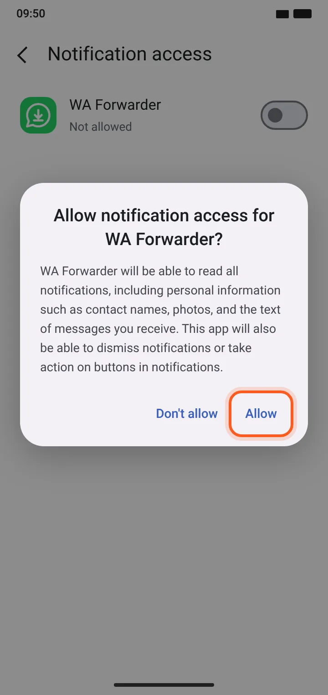 |
| **9** | **סוללה.** לוחצים **Allow** ליד **Run in background**. בסמסונג, שיאומי ווואווי צריך גם לאשר הפעלה אוטומטית, או לסמן את האפליקציה כ״לא נכנסת לשינה״. | 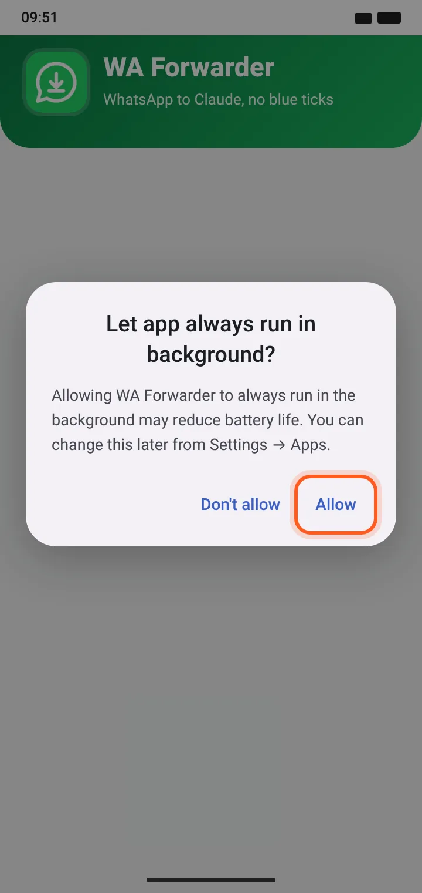 |
| **10** | **בדיקה.** לוחצים **Send test message**. אמורים להופיע **Active · forwarding** ו־**Sent OK**. לא לשכוח להדליק שוב את הסריקה של Play Protect. | 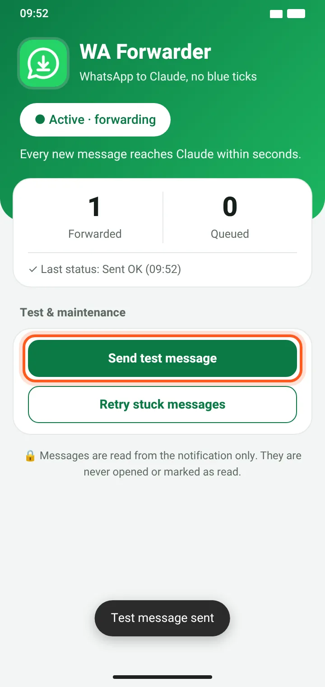 |
| **11** | **מחברים את Claude** (במחשב). ב־claude.ai: Settings ← Connectors ← **Add custom connector**. בשם כותבים `WhatsApp`, ובכתובת מדביקים את כתובת ה־connector מדף ההגדרה. את Advanced settings משאירים ריק. | 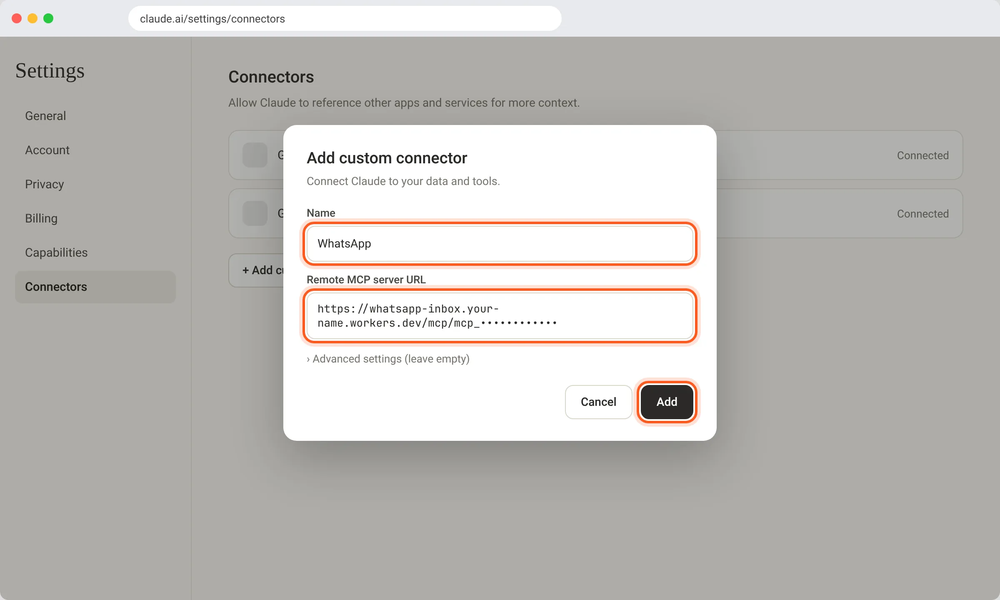 |
| **12** | **שואלים את Claude:** ״מה הגיע לי היום בווצאפ?״. Claude רואה רק הודעות שהגיעו אחרי ההתקנה. | 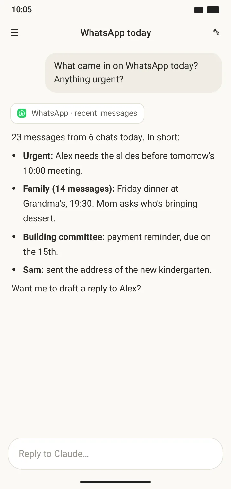 |

רוצים את המדריך כדף אינטרנט מעוצב עם כתובת השרת שלכם? Claude Code מפיק אותו עם
`node guide/make-guide.mjs --server https://whatsapp-inbox.<you>.workers.dev` (פירוט ב־[CLAUDE.md](../CLAUDE.md), שלב 11).

### תקלות נפוצות

- **המתג אפור:** זו ״הגדרה מוגבלת״. ראו שלב 7.
- **ההודעות מפסיקות להגיע אחרי כמה שעות:** חיסכון הסוללה של הטלפון עצר את האפליקציה. סמסונג: סוללה ← הגבלות שימוש ברקע ← ״אפליקציות שאף פעם לא נכנסות למצב שינה״. שיאומי: פרטי האפליקציה ← להדליק הפעלה אוטומטית, ובחיסכון בסוללה לבחור ״ללא הגבלות״. וואווי: סוללה ← הפעלת אפליקציות ← ניהול ידני.
- **הסטטוס מראה 401:** המפתח השתנה. פותחים את קישור ההגדרה העדכני ולוחצים שוב ״Set up the app automatically״.
- **חסרות הודעות:** הודעות מצ׳אטים מושתקים, מצ׳אטים שפתוחים על המסך, ומדיה, לא מופיעות בהתראות, ולכן גם לא מגיעות.

