# 📱 Installing the WA Forwarder app

**English** · [עברית](install-app.he.md)

You need your **personal setup link** first (the server owner creates it on the admin page, `/<server>/admin`).
About 10 minutes. The orange frame in each screenshot marks what to tap. All values in the screenshots are made up.

> ⚠️ Using this tool is at your own discretion and risk. See the [disclaimer](../README.md#disclaimer).

| | Step | |
|---|---|---|
| **1** | **Open your setup link on the phone**, in Chrome (or scan its QR code). Tap **Download the app**. Keep the page open. | 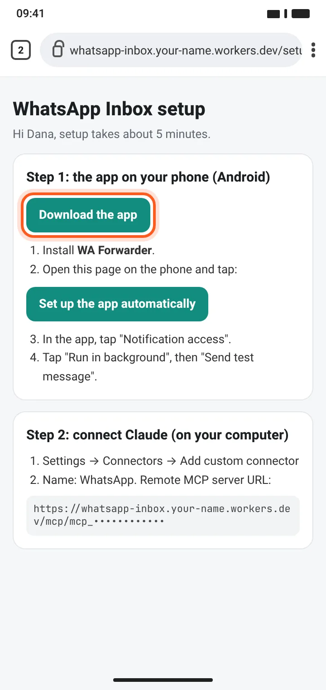 |
| **2** | **Confirm the download.** Chrome warns about any file not from Google Play. Tap **Download anyway**, then **Open**. | 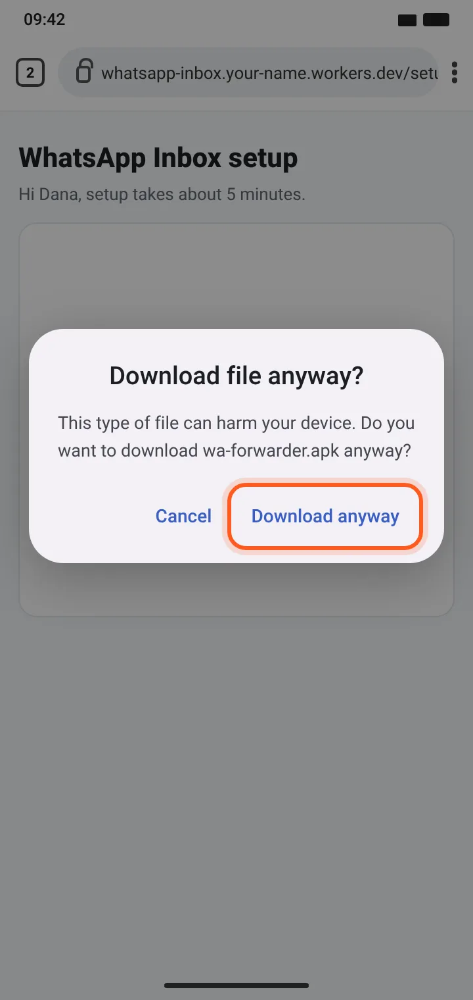 |
| **3** | **Let Chrome install apps.** Tap Settings → turn on **Allow from this source** → back. (Not shown? Already allowed.) | 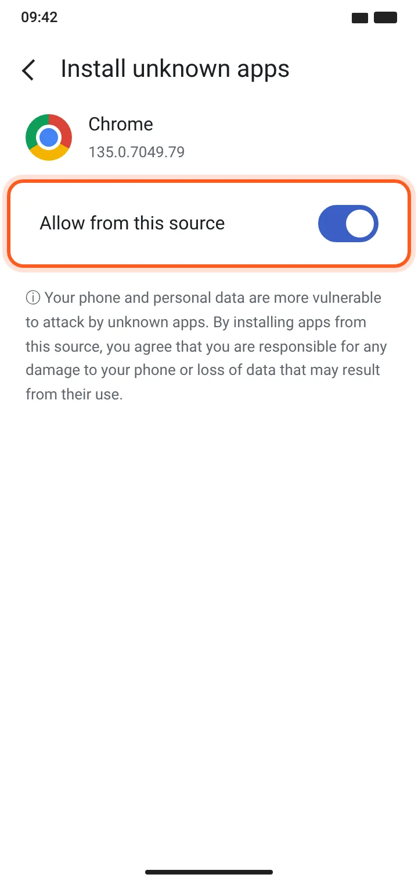 |
| **4** | **Get past Play Protect.** Tap **More details → Install anyway**. If that's missing: Google Play → profile → Play Protect → ⚙️ → turn off **Scan apps with Play Protect**, install, and **turn it back on** afterwards. | 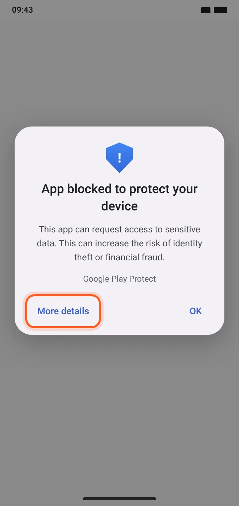 |
| **5** | **Install.** If you get "App not installed", uninstall an older copy signed with a different key first. | 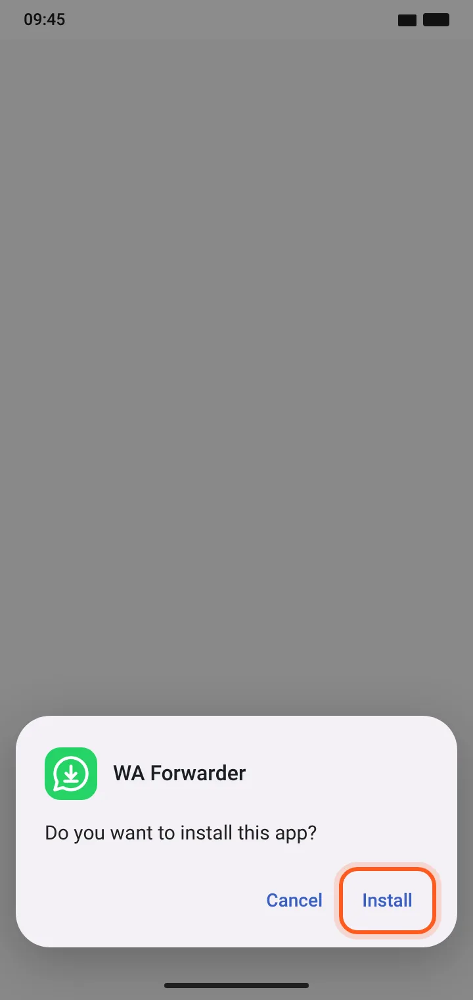 |
| **6** | **One-tap setup.** Back on the setup page, tap **Set up the app automatically**. "Connect to server" turns green. Then tap **Allow** next to **Notification access**. | 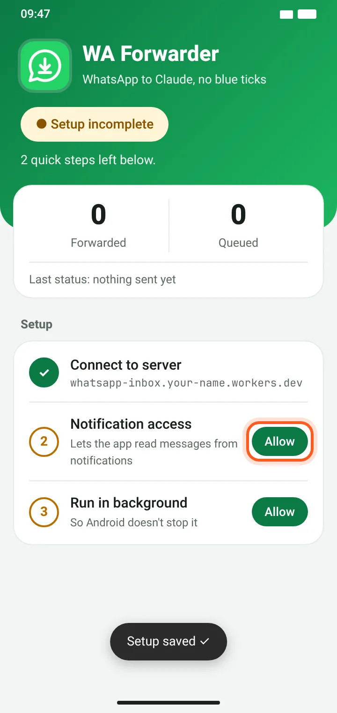 |
| **7** | **Restricted setting** (Android 13+). The switch is greyed out: tap OK, then Settings → Apps → WA Forwarder → **⋮ → Allow restricted settings**. | 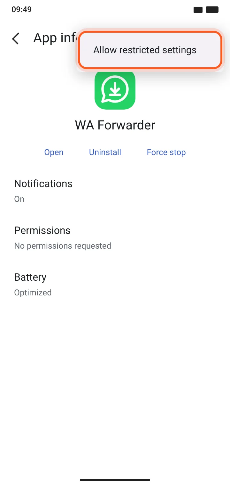 |
| **8** | **Allow notification access.** Back in the app, tap **Allow** again, turn on the switch and confirm. | 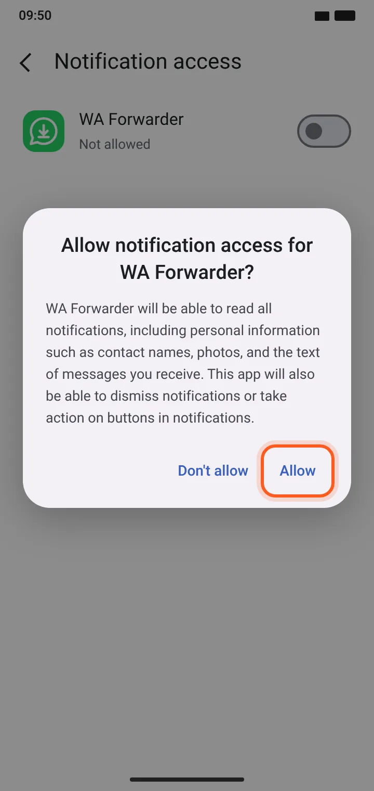 |
| **9** | **Battery.** Tap **Allow** next to **Run in background**. Samsung / Xiaomi / Huawei: also allow autostart or "never sleeping". | 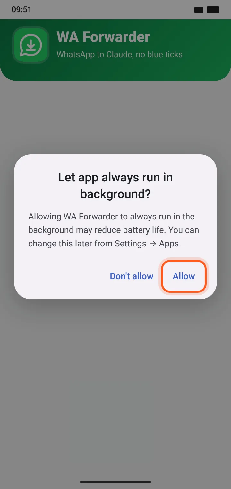 |
| **10** | **Test.** Tap **Send test message**. You should see **Active · forwarding** and **Sent OK**. Remember to turn Play Protect scanning back on. | 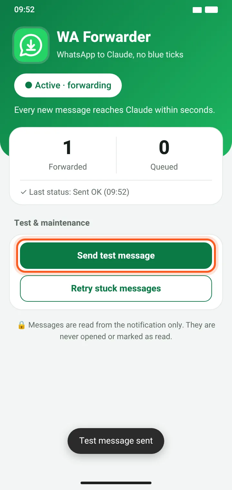 |
| **11** | **Connect Claude** (on a computer). claude.ai → Settings → Connectors → **Add custom connector**. Name `WhatsApp`, URL = the connector URL from your setup page. Leave Advanced settings empty. | 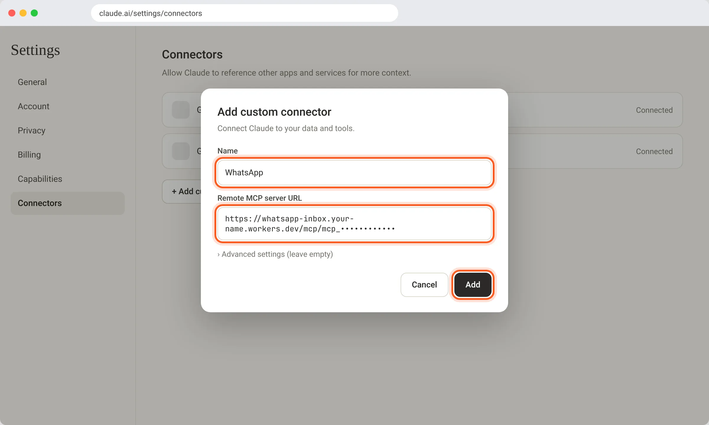 |
| **12** | **Ask Claude:** "What came in on WhatsApp today?" Only messages that arrived after the install are available. | 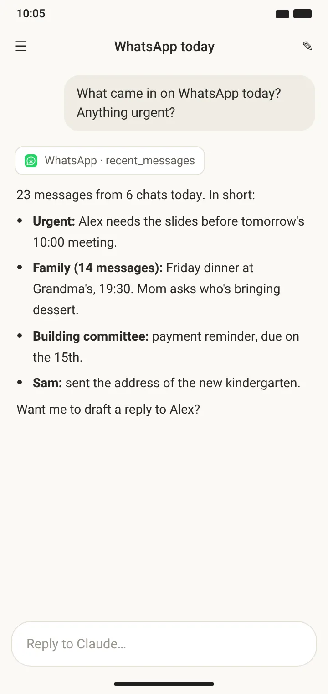 |

Want this as a polished web page with your server's address? Claude Code makes one with
`node guide/make-guide.mjs --server https://whatsapp-inbox.<you>.workers.dev` (see [CLAUDE.md](../CLAUDE.md), Phase 11).

### Troubleshooting

- **Switch greyed out:** that's "Restricted setting", step 7.
- **Messages stop after a few hours:** the phone's battery saver. Samsung: Battery → Background usage limits → "Never sleeping apps". Xiaomi: App info → Autostart on, Battery saver → No restrictions. Huawei: Battery → App launch → Manage manually.
- **Status shows 401:** the key changed. Open the latest setup link and tap "Set up the app automatically" again.
- **Missing messages:** muted chats, chats open on screen, and media don't show in notifications, so they don't arrive.
